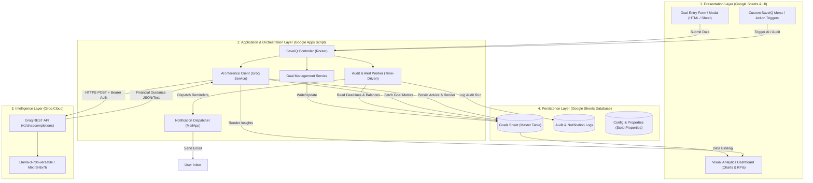
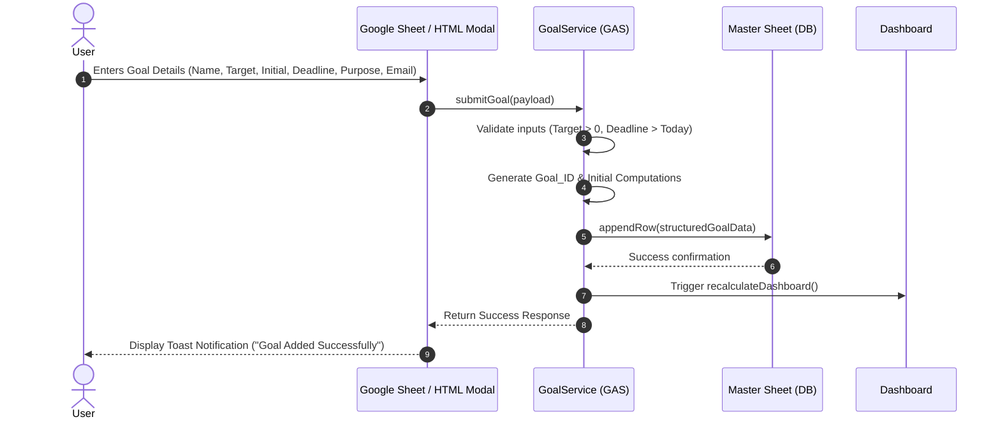
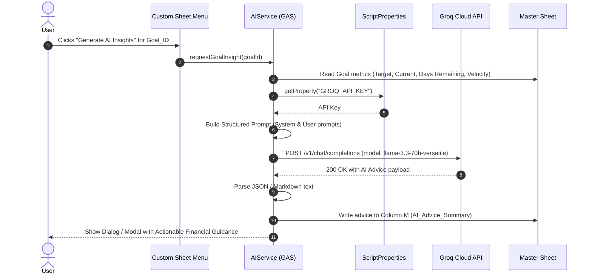
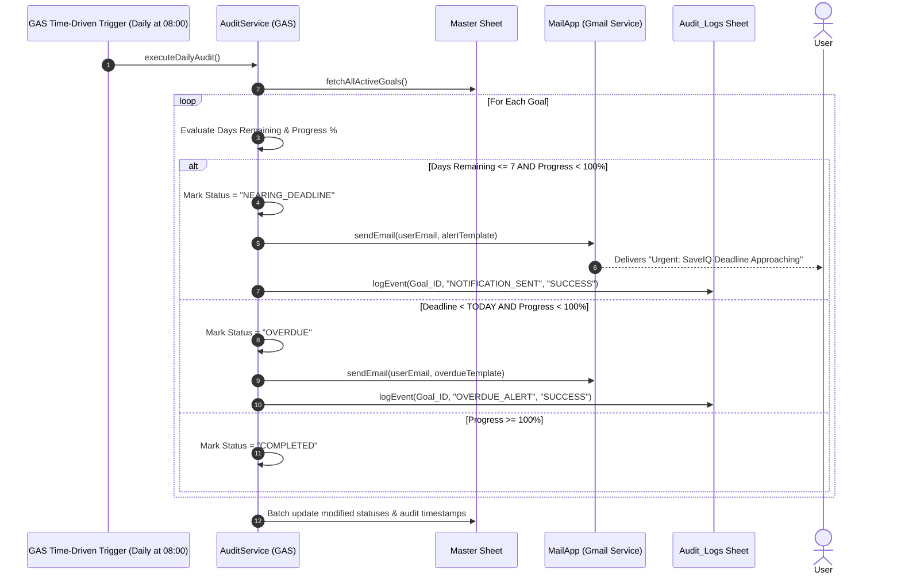
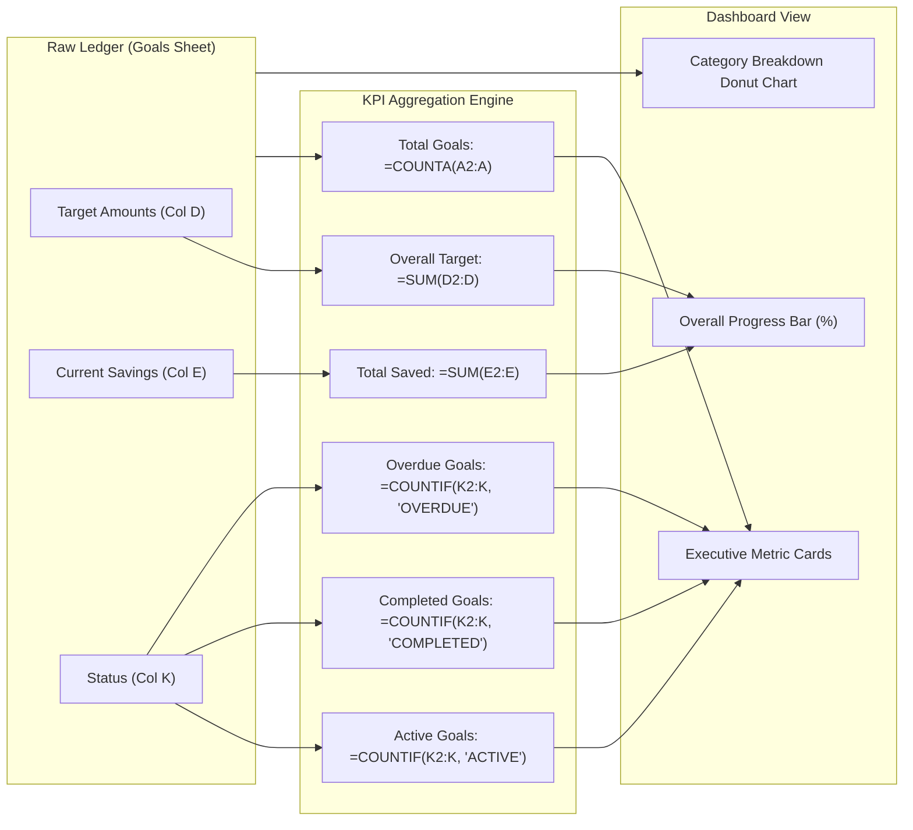
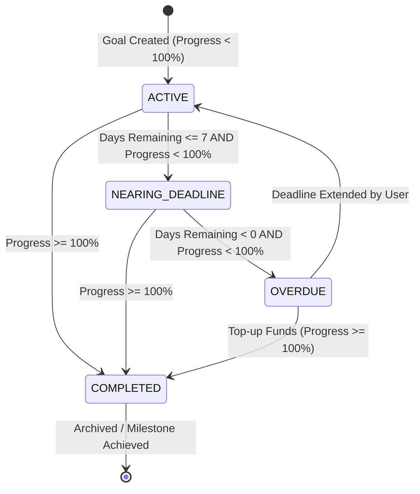

# SaveIQ – AI Savings Goal Tracker
## Detailed System Architecture Document (`architecture.md`)

---

## 1. Architectural Overview & Design Principles

**SaveIQ** is built on a serverless, event-driven, zero-maintenance architectural framework. It harnesses the capabilities of **Google Workspace (Sheets & Apps Script)** as the data layer, execution environment, and user interface, paired with **Groq Cloud API** for ultra-low latency Large Language Model (LLM) financial reasoning.

### Core Architectural Principles
1. **Zero-Infrastructure Footprint:** No dedicated servers, containers, or databases to provision; operates entirely within Google's cloud ecosystem.
2. **Event-Driven & Reactive:** Responds instantaneously to user actions (form submissions, menu clicks, spreadsheet edits) and scheduled time triggers (daily background audits).
3. **Decoupled AI Intelligence:** Groq API handles compute-heavy probabilistic reasoning (financial analysis, recommendation generation) through asynchronous REST endpoints, keeping sheet calculations lightweight.
4. **Resilient Data Integrity:** Atomic row appending, cell validation rules, and schema segregation ensure consistency across financial ledger records.

---

## 2. High-Level Architecture Diagram



---

## 3. Layered Component Breakdown

### 3.1. Presentation Layer (UI & Dashboard)
- **Goal Entry Interface:** 
  - Standardized input range or GAS HTML Service modal with strict client-side validation (types, positive values, future dates).
- **Financial Dashboard:**
  - KPI Cards: Total Savings, Total Goals, Completed Goals, Overdue Goals, Active Savings Velocity ($/day).
  - Visualization: Progress bars, category allocation charts, target vs. actual timeline graphs.
- **Custom Workspace Menu (`onOpen`):**
  - Custom UI menu added dynamically: `SaveIQ > Add Goal`, `SaveIQ > Generate AI Insights`, `SaveIQ > Run Manual Audit`.

### 3.2. Application & Execution Layer (Google Apps Script)
Google Apps Script acts as the centralized backend runtime:
- **`GoalService.js`:** Manages CRUD operations for goals, calculates initial projection metrics, validates uniqueness and payload sanitization.
- **`AIService.js`:** Formulates context-rich prompt payloads from sheet data, invokes the Groq HTTP API via `UrlFetchApp`, parses responses, and handles fallbacks.
- **`AuditService.js`:** Invoked by time-based triggers; computes delta days, remaining amounts, identifies delinquent or approaching deadlines.
- **`NotificationService.js`:** Renders HTML-formatted transactional emails with dynamic progress bars and actionable financial advice.

### 3.3. Intelligence Layer (Groq API)
- **Endpoint:** `https://api.groq.com/openai/v1/chat/completions`
- **Model:** `llama-3.3-70b-versatile` or `mixtral-8x7b-32768` (sub-second inference speed for instant UI responsiveness).
- **Security:** API Key secured in Google Apps Script `PropertiesService.getScriptProperties()`. Never hardcoded in sheets or client-side scripts.

### 3.4. Persistence Layer (Google Sheets Schema)
Spreadsheets act as a relational tabular store with structured schemas across dedicated sheets.

---

## 4. Data Model & Database Schema

### Table 1: `Goals` (Primary Entity Sheet)

| Column Index | Field Name | Data Type | Formula / Origin | Description |
| :--- | :--- | :--- | :--- | :--- |
| **A** | `Goal_ID` | String (UUID) | System Generated | Unique primary identifier (e.g., `GID-98234`) |
| **B** | `Goal_Name` | String | User Input | Name of the objective (e.g., "Emergency Fund") |
| **C** | `Purpose_Category` | String | User Input | Enum: `Emergency`, `Tech`, `Travel`, `Education`, `Lifestyle` |
| **D** | `Target_Amount` | Number (Currency) | User Input | Monetary target |
| **E** | `Current_Savings` | Number (Currency) | User Input / Log | Cumulative amount currently saved |
| **F** | `Remaining_Balance` | Number (Currency) | `=D2-E2` | Remaining deficit to reach target |
| **G** | `Progress_Percentage`| Percentage | `=E2/D2` | Progress normalized to 100% |
| **H** | `Deadline` | Date (YYYY-MM-DD) | User Input | Expected completion date |
| **I** | `Days_Remaining` | Integer | `=DATEDIF(TODAY(), H2, "D")` | Days remaining until deadline |
| **J** | `Required_Daily_Rate`| Number (Currency) | `=IF(I2>0, F2/I2, F2)` | Required daily savings velocity |
| **K** | `Status` | Enum String | Auto/Calculated | `ACTIVE`, `NEARING_DEADLINE`, `COMPLETED`, `OVERDUE` |
| **L** | `Alert_Email` | String | User Input | User's email for automated alerts |
| **M** | `AI_Advice_Summary` | Text | Groq API Output | Latest generated financial advice |
| **N** | `Last_Audited_At` | Timestamp | System Updated | Timestamp of last audit pass |
| **O** | `Created_At` | Timestamp | System Updated | Creation timestamp |

---

### Table 2: `Audit_Logs` (Event Ledger Sheet)

| Column Index | Field Name | Data Type | Description |
| :--- | :--- | :--- | :--- |
| **A** | `Log_ID` | UUID | Unique log entry ID |
| **B** | `Goal_ID` | String (FK) | Reference to `Goals.Goal_ID` |
| **C** | `Timestamp` | ISO Timestamp | Execution timestamp |
| **D** | `Trigger_Type` | Enum | `DAILY_CRON`, `MANUAL_AUDIT`, `AI_SYNC` |
| **E** | `Notification_Sent`| Boolean | Whether an email alert was dispatched |
| **F** | `Message_Status` | String | `SUCCESS`, `RATE_LIMITED`, `FAILED` |
| **G** | `Details` | Text | Summary of action taken |

---

## 5. Sequence Flows & Operational Scenarios

### Scenario 1: Savings Goal Creation Sequence



---

### Scenario 2: AI Financial Recommendations (Groq API)



#### Groq Prompt Construction Architecture
- **System Prompt:**
  ```text
  You are SaveIQ Financial Advisor, an empathetic yet strictly disciplined financial coach. 
  Given the user's savings goal, target amount, current savings, days remaining, and required daily savings rate,
  provide concise, realistic, high-impact strategies to hit the target. Highlight practical budget tweaks.
  Keep advice under 120 words with 3 bullet points.
  ```
- **User Prompt Payload:**
  ```json
  {
    "goalName": "Laptop Purchase",
    "category": "Tech",
    "targetAmount": 1500,
    "currentSavings": 600,
    "remainingDeficit": 900,
    "daysRemaining": 45,
    "requiredDailyRate": 20.00
  }
  ```

---

### Scenario 3: Automated Deadline Audits & Email Alerts



---

### Scenario 4: Financial Dashboard KPI Aggregation

The dashboard is generated using formula-driven cell linkages and Google Sheets embedded charts to ensure real-time responsiveness without custom front-end hosting overhead.



---

## 6. Security, Authentication & Configuration

| Requirement | Implementation Mechanism | Justification |
| :--- | :--- | :--- |
| **API Secret Protection** | `PropertiesService.getScriptProperties().setProperty('GROQ_API_KEY', key)` | Keeps credentials out of source code, git history, and spreadsheet cells. |
| **User Access Control** | Google Workspace IAM (Viewer / Editor permissions) | Leverages Google OAuth2 for spreadsheet read/write authorization. |
| **Data Transmission Security** | TLS 1.3 / HTTPS for all Groq API calls | Prevents interception of financial telemetry during transit. |
| **Rate Limit Management** | Exponential backoff retry logic in `UrlFetchApp` | Safeguards against HTTP 429 errors from Groq API during bulk analysis. |

---

## 7. State Machine: Goal Lifecycle



---

## 8. Directory & Script File Structure

```
SaveIQ/
├── problem_statement.md        # Problem Definition & Functional Scenarios
├── architecture.md             # End-to-End System Architecture (This file)
└── src/                        # Google Apps Script Source Code
    ├── appsscript.json         # Project Manifest & OAuth Scopes
    ├── Main.js                 # onOpen, Menu bindings & Orchestrator
    ├── GoalService.js          # Goal CRUD, row parsing & data validation
    ├── AIService.js            # Groq API payload formulation & client calls
    ├── AuditService.js         # Daily audit cron logic & state evaluation
    ├── NotificationService.js  # HTML email templating & dispatch
    └── UI/
        ├── GoalModal.html      # Add Goal User Interface form
        └── Styles.html         # CSS styling for modals and dialogs
```
