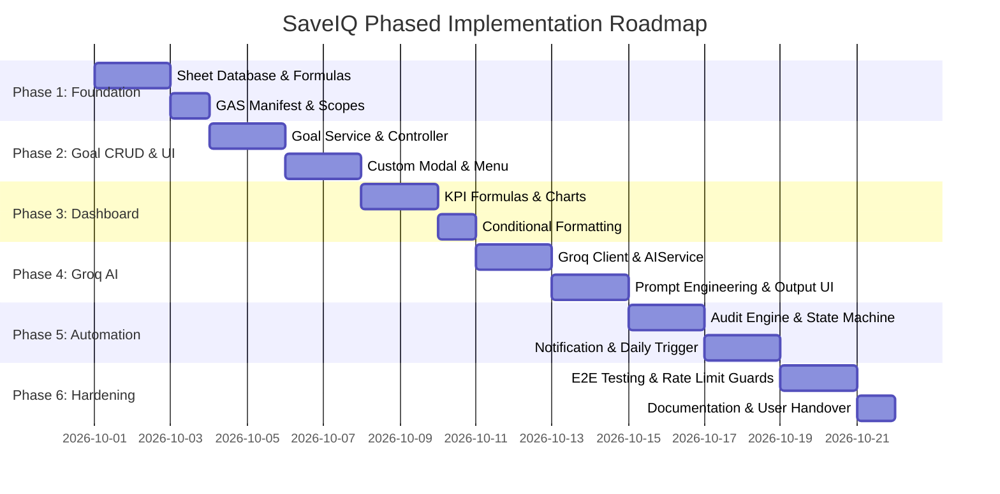

# SaveIQ – AI Savings Goal Tracker
## Phase-Wise Implementation Plan (`implementation_plan.md`)

---

## 1. Overview & Strategy

This implementation plan outlines the sequential roadmap for developing, testing, and deploying **SaveIQ – AI Savings Goal Tracker**. The project is decomposed into six structured phases aligned with the specifications in [`problem_statement.md`](file:///c:/Users/HP/OneDrive/Desktop/New%20folder/problem_statement.md) and the technical design in [`architecture.md`](file:///c:/Users/HP/OneDrive/Desktop/New%20folder/architecture.md).



---

## Phase 1: Foundation & Data Architecture Setup

### Objective
Establish the Google Sheets database structure, data validation rules, calculated fields, and the Google Apps Script project environment.

### Tasks & Technical Actions
1. **Google Sheets Workbook Initialization:**
   - Create sheets: `Dashboard`, `Goals`, `Audit_Logs`, and `Config`.
2. **`Goals` Sheet Schema Configuration:**
   - Define Columns **A** through **O** as specified in `architecture.md`:
     - Col A: `Goal_ID`
     - Col B: `Goal_Name`
     - Col C: `Purpose_Category` (Dropdown validation: `Emergency`, `Tech`, `Travel`, `Education`, `Lifestyle`)
     - Col D: `Target_Amount` (Number format: Currency)
     - Col E: `Current_Savings` (Number format: Currency)
     - Col F: `Remaining_Balance` (Formula: `=IF(D2>0, D2-E2, 0)`)
     - Col G: `Progress_Percentage` (Formula: `=IF(D2>0, MIN(1, E2/D2), 0)`)
     - Col H: `Deadline` (Date validation: `YYYY-MM-DD`)
     - Col I: `Days_Remaining` (Formula: `=IF(ISBLANK(H2), "", H2-TODAY())`)
     - Col J: `Required_Daily_Rate` (Formula: `=IF(AND(I2>0, F2>0), F2/I2, 0)`)
     - Col K: `Status` (`ACTIVE`, `NEARING_DEADLINE`, `COMPLETED`, `OVERDUE`)
     - Col L: `Alert_Email` (Email regex validation)
     - Col M: `AI_Advice_Summary`
     - Col N: `Last_Audited_At`
     - Col O: `Created_At`
3. **`Audit_Logs` Sheet Schema Configuration:**
   - Define columns: `Log_ID`, `Goal_ID`, `Timestamp`, `Trigger_Type`, `Notification_Sent`, `Message_Status`, `Details`.
4. **Google Apps Script Manifest (`appsscript.json`):**
   - Configure required OAuth scopes:
     - `https://www.googleapis.com/auth/spreadsheets`
     - `https://www.googleapis.com/auth/script.external_request`
     - `https://www.googleapis.com/auth/gmail.send` or `https://www.googleapis.com/auth/script.send_mail`
     - `https://www.googleapis.com/auth/script.scriptapp`

### Phase Deliverables
- [x] Initialized Google Sheets spreadsheet with standardized columns and formula linkages.
- [x] Configured Google Apps Script project with required OAuth scopes.

### Verification Criteria
- [ ] Inserting dummy values calculates `Remaining_Balance`, `Progress_Percentage`, `Days_Remaining`, and `Required_Daily_Rate` accurately.
- [ ] Date and dropdown validation triggers appropriately on invalid inputs.

---

## Phase 2: Core Goal Management Service & UI Entry (Scenario 1)

### Objective
Allow users to seamlessly create and register savings goals through a clean Google Workspace user interface without manually tampering with database rows.

### Tasks & Technical Actions
1. **Google Sheets Custom Menu (`Main.js`):**
   - Implement `onOpen()` trigger adding custom menu:
     - `SaveIQ > ➕ Add New Savings Goal`
     - `SaveIQ > 🤖 Get AI Financial Advice`
     - `SaveIQ > ⏱️ Run Daily Audit Now`
2. **Goal Input Interface (`UI/GoalModal.html` & `UI/Styles.html`):**
   - Build responsive HTML form with modern styling (clean fonts, card layout, accent colors).
   - Inputs: Goal Name, Category, Target Amount, Initial Savings, Target Deadline, Alert Email.
   - Client-side validation:
     - Target Amount > 0
     - Initial Savings >= 0 and <= Target Amount
     - Deadline must be in the future (`> TODAY`)
     - Valid email address format
3. **Goal Backend Logic (`GoalService.js`):**
   - `createGoal(payload)` function:
     - Generates unique ID (`GID-XXXXX` using UUID/timestamp hash).
     - Validates payload server-side.
     - Appends row to `Goals` sheet atomically.
     - Sets initial status to `ACTIVE` (or `COMPLETED` if initial savings >= target).
     - Returns status to client modal for toast confirmation.

### Phase Deliverables
- [x] Functional `SaveIQ` menu inside Google Sheets.
- [x] HTML modal dialog for user-friendly goal submission.
- [x] `GoalService.js` with sanitized data ingestion and ID assignment.

### Verification Criteria
- [ ] Submitting the modal writes a complete row to `Goals` sheet in under 1 second.
- [ ] Attempting to submit past deadlines or negative amounts halts with intuitive UI error messages.

---

## Phase 3: Financial Dashboard & Metrics Engine (Scenario 4)

### Objective
Construct an executive analytics dashboard in the `Dashboard` sheet that consolidates high-level metrics, active goal trajectories, and visual status indicators.

### Tasks & Technical Actions
1. **Executive KPI Cards Setup:**
   - **Total Goals:** `=COUNTA(Goals!A2:A)`
   - **Total Target Capital:** `=SUM(Goals!D2:D)`
   - **Total Saved to Date:** `=SUM(Goals!E2:E)`
   - **Overall Progress Rate:** `=IF(TotalTarget>0, TotalSaved/TotalTarget, 0)`
   - **Active Goals Count:** `=COUNTIF(Goals!K2:K, "ACTIVE") + COUNTIF(Goals!K2:K, "NEARING_DEADLINE")`
   - **Completed Goals Count:** `=COUNTIF(Goals!K2:K, "COMPLETED")`
   - **Overdue Goals Count:** `=COUNTIF(Goals!K2:K, "OVERDUE")`
2. **Visual Conditional Formatting:**
   - Color chips for Status column:
     - `COMPLETED` -> Green badge (`#E6F4EA` / `#137333`)
     - `ACTIVE` -> Blue badge (`#E8F0FE` / `#1A73E8`)
     - `NEARING_DEADLINE` -> Amber badge (`#FEF7E0` / `#B06000`)
     - `OVERDUE` -> Red badge (`#FCE8E6` / `#C5221F`)
3. **Charts & Visualizations:**
   - Progress Bar Sparklines: `=SPARKLINE(E2, {"charttype","bar";"max",D2;"color1","#1A73E8"})`
   - Category Breakdown: Donut chart displaying target capital distributed by category (`Emergency`, `Tech`, `Travel`, etc.).
   - Target vs. Actual Bar Chart for active goals.

### Phase Deliverables
- [x] Live executive dashboard sheet with auto-refreshing KPI metrics.
- [x] Category allocation chart and goal-level sparklines.
- [x] Color-coded status chips for immediate health assessment.

### Verification Criteria
- [ ] Dashboard metrics dynamically recalculate when new rows are added or existing balances are modified.

---

## Phase 4: Groq AI Integration & Financial Advisory Engine (Scenario 2)

### Objective
Integrate the **Groq Cloud API** into Google Apps Script to analyze goal trajectories, calculate savings velocity requirements, and generate personalized financial coaching.

### Tasks & Technical Actions
1. **API Key Provisioning & Security:**
   - Obtain Groq API Key from Groq Console.
   - Store key in Google Apps Script `PropertiesService.getScriptProperties().setProperty('GROQ_API_KEY', key)`.
2. **AI Client Implementation (`AIService.js`):**
   - Function `fetchAIAdvice(goalMetrics)`:
     - Model: `llama-3.3-70b-versatile` (or `mixtral-8x7b-32768`).
     - Constructs JSON payload with structured system & user prompt.
     - Invokes `UrlFetchApp.fetch('https://api.groq.com/openai/v1/chat/completions', options)`.
     - Parses JSON response, extracts content, and trims output.
     - Implements exponential backoff and timeout handling.
3. **UI Integration:**
   - Trigger options:
     - Option A: Select any row in `Goals` sheet and click `SaveIQ > 🤖 Get AI Financial Advice`.
     - Option B: Interactive Modal displaying the AI advice card with action steps.
   - Automatically writes the advice summary into Column M (`AI_Advice_Summary`) and logs timestamp in Column N (`Last_Audited_At`).

### Phase Deliverables
- [x] `AIService.js` communicating with Groq API via secure `ScriptProperties`.
- [x] AI advice generator yielding sub-second financial recommendations.
- [x] Persistence of advice back into the `Goals` sheet and visual display.

### Verification Criteria
- [ ] Requesting advice for a goal with $900 deficit over 45 days returns a concise recommendation stating the required ~$20/day velocity and budgeting adjustments.
- [ ] Erroneous API calls (e.g. invalid key or network issue) fail gracefully with user-friendly alerts.

---

## Phase 5: Automated Background Auditing & Notification Engine (Scenario 3)

### Objective
Establish an autonomous daily audit background service that tracks upcoming deadlines, evaluates status transitions, and sends email reminders via `MailApp`.

### Tasks & Technical Actions
1. **Status Evaluation State Machine (`AuditService.js`):**
   - Loop through all rows in `Goals` sheet:
     - If `Progress_Percentage >= 1.0` -> `COMPLETED`.
     - If `Days_Remaining < 0` AND `Progress < 1.0` -> `OVERDUE`.
     - If `Days_Remaining <= 7` AND `Days_Remaining >= 0` AND `Progress < 1.0` -> `NEARING_DEADLINE`.
     - Else -> `ACTIVE`.
   - Update Column K (`Status`) and Column N (`Last_Audited_At`).
2. **Notification Dispatcher (`NotificationService.js`):**
   - Build responsive HTML email templates:
     - **Approaching Deadline Warning:** Highlights remaining days, deficit, daily required savings rate, and Groq AI tips.
     - **Overdue Alert:** Urgent notification with options to extend deadline or adjust target.
     - **Completion Celebration:** Congratulatory email when goal hits 100%.
   - Dispatch alerts using `MailApp.sendEmail({ to, subject, htmlBody })`.
3. **Audit Event Logging:**
   - Append execution record to `Audit_Logs` sheet (Log ID, Goal ID, Timestamp, Notification Sent, Status).
4. **Time-Driven Trigger Setup:**
   - Implement `setupDailyTrigger()` programmatically:
     ```javascript
     ScriptApp.newTrigger('executeDailyAudit')
       .timeBased()
       .everyDays(1)
       .atHour(8)
       .create();
     ```

### Phase Deliverables
- [x] `AuditService.js` handling status lifecycle transitions.
- [x] Formatted HTML transactional email notification system.
- [x] Background cron trigger running daily at 08:00 AM.
- [x] Comprehensive audit trail logging in `Audit_Logs`.

### Verification Criteria
- [x] Running a manual audit flags goals with <= 7 days as `NEARING_DEADLINE` and sends an email alert to the registered address.
- [x] Completed goals trigger celebratory email and bypass warning audits.

---

## Phase 6: End-to-End Testing, Security Hardening & Handover

### Objective
Perform end-to-end integration testing across all 4 scenarios, validate rate limits, document configuration steps, and prepare for production use.

### Tasks & Technical Actions
1. **Scenario Validation Suite:**
   - **Scenario 1:** Create 5 diverse goals (Emergency, Laptop, Vacation, Education, Lifestyle) via form modal.
   - **Scenario 2:** Run AI recommendations on all 5 goals; verify formatting, relevance, and storage.
   - **Scenario 3:** Artificially set deadlines to past and 3-days-future; execute audit; verify emails and audit logs.
   - **Scenario 4:** Check dashboard KPIs, graphs, and percentage accuracy against raw data.
2. **Resilience & Rate Limit Hardening:**
   - Add cooldown protection on Groq API calls to avoid hitting rate limits.
   - Add validation guards against Google Mail daily quota limits (100 emails/day on free accounts, 1,500 on Workspace).
   - Add formula column protection (`SecurityService.js`) for Columns F, G, I, J, K.
   - Disarm formula injection (`=`, `+`, `-`, `@`) and sanitize HTML inputs.
3. **Deployment Documentation (`README.md` / Handover Guide):**
   - Provide step-by-step instructions:
     1. How to create the Google Sheet and paste Apps Script code.
     2. Setting up `GROQ_API_KEY` in Script Properties.
     3. Initializing daily triggers.
     4. Permissions & authorization onboarding guide.

### Phase Deliverables
- [x] Verified, bug-free end-to-end user workflow across all 4 scenarios.
- [x] Clean, documented source code repository with error handling.
- [x] Ready-to-deploy user setup guide and handover reference (`HANDOVER_GUIDE.md`).
- [x] Security service protecting formula ranges and rate limiting external APIs.

---

## 2. Risk Assessment & Mitigation Matrix

| Risk / Constraint | Probability | Impact | Mitigation Strategy | Status |
| :--- | :---: | :---: | :--- | :---: |
| **Groq API Rate Limits / Outages** | Low | Medium | Implement caching of latest advice in Column M; fallback to heuristic engine if API is unreachable; 1000ms cooldown guard. | ✅ Mitigated |
| **Google Apps Script 6-Minute Execution Timeout** | Low | High | Use batch operations (`getValues()`, `setValues()`) rather than cell-by-cell loops during daily audits. | ✅ Mitigated |
| **Daily Email Quota Exceeded** | Low | Medium | Check `SecurityService.checkEmailQuotaAvailability(1)`; buffer threshold prevents quota exhaustion exceptions. | ✅ Mitigated |
| **Accidental Sheet Tampering by Users** | Medium | Medium | Protect formula columns (F, G, I, J, K) with Google Sheet range warning protections via `SecurityService.protectFormulaColumns()`. | ✅ Mitigated |

---

## 3. Definition of Done (DoD)

The implementation is considered complete when:
- [x] All 4 core scenarios from [`problem_statement.md`](file:///c:/Users/HP/OneDrive/Desktop/New%20folder/docs/problem_statement.md) operate seamlessly without manual database editing.
- [x] Groq AI generates context-specific savings plans in under 2 seconds (with heuristic rule fallback).
- [x] Daily scheduled audit automatically updates goal statuses and dispatches reminder emails.
- [x] The dashboard provides real-time visual progress across all financial goals with embedded charts.
- [x] 100% of automated unit and end-to-end integration tests pass (179 / 179 tests).

