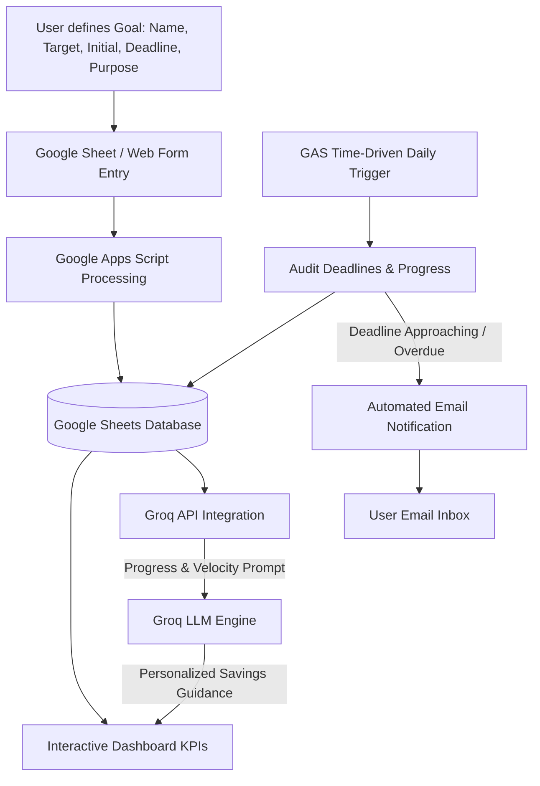

# SaveIQ – AI Savings Goal Tracker
## Problem Statement & System Overview

---

## 1. Project Overview

**SaveIQ – AI Savings Goal Tracker** is an intelligent personal finance management application designed to empower individuals to define, track, and achieve their savings goals with financial discipline. Combining cloud-native spreadsheets, serverless automation, and modern Large Language Model (LLM) intelligence, SaveIQ bridges the gap between passive financial record-keeping and proactive, AI-driven financial coaching.

---

## 2. Problem Statement

Many individuals struggle to meet personal financial milestones (e.g., building an emergency fund, purchasing high-value assets, planning vacations, or eliminating debt) due to:

- **Lack of Goal Structure:** Savings are often informal without clear target numbers, timelines, or milestone tracking.
- **Absence of Actionable Insights:** Traditional budgeting apps and spreadsheets record data passively but do not suggest how to adjust spending or bridge savings deficits.
- **Inconsistent Accountability:** Without automated monitoring and proactive alerts, users frequently lose track of deadlines until goals become overdue.
- **High Friction in Complex Tools:** Standard enterprise finance tools are overly complex, whereas simple notes lack analytics, automation, and real-time guidance.

SaveIQ solves these challenges by providing a streamlined, accessible, and automated tracking system powered by **Google Sheets**, **Google Apps Script**, and **Groq AI**.

---

## 3. Technology Stack & Architecture

| Component | Technology | Role / Purpose |
| :--- | :--- | :--- |
| **User Interface & Storage** | Google Sheets | Acts as the central database, ledger, and visual dashboard. |
| **Business Logic & Automation** | Google Apps Script (GAS) | Handles form ingestion, calculations, background daily triggers, and API orchestration. |
| **AI Intelligence Engine** | Groq API (Fast LLM Inference) | Analyzes goal trajectories, savings velocities, and generates personalized financial advice. |
| **Notification Engine** | Google Apps Script (MailApp / GmailApp) | Dispatches automated milestone reminders and deadline warnings to users. |

---

## 4. Core System Scenarios & Functional Requirements

### Scenario 1: Savings Goal Creation
* **Description:** A user defines a new financial goal (e.g., *Emergency Fund*, *Laptop Purchase*, *Vacation Plan*).
* **Input Parameters:**
  - **Goal Name:** Descriptive title of the objective.
  - **Target Amount ($ / ₹ / etc.):** Total sum required to reach the goal.
  - **Initial Savings:** Amount already saved or allocated at creation.
  - **Deadline:** Target completion date.
  - **Email Alerts:** User email address and notification frequency preferences.
  - **Purpose / Category:** Reason for saving (e.g., Emergency, Education, Technology, Travel, Lifestyle).
* **System Action:** 
  - Validates all input fields.
  - Stores the goal entry in the Google Sheets database with auto-computed metadata (Creation Date, Remaining Balance, Target Daily/Monthly Savings Velocity, Completion Status).
  - Immediately updates and reflects the new entry on the active dashboard.

---

### Scenario 2: AI Financial Recommendations
* **Description:** The user requests or triggers AI-driven insights for an individual goal or overall portfolio.
* **System Action:**
  - Evaluates current progress: `(Current Savings / Target Amount) * 100`.
  - Calculates remaining days until deadline and required periodic savings rate.
  - Sends structured prompts with financial parameters to the **Groq API**.
  - Groq AI generates context-aware, actionable recommendations (e.g., *"To hit your Laptop goal in 45 days, allocate $12/day. Consider reducing discretionary dining expenses by 15% this month"*).
  - Populates recommendations directly into the dashboard interface or reports.

---

### Scenario 3: Automated Deadline Alerts & Monitoring
* **Description:** The system runs autonomous background audits to keep users accountable.
* **System Action:**
  - A Google Apps Script time-driven trigger executes daily.
  - Scans active goals against current date and target deadlines.
  - Flags goals that are at risk, nearing deadlines (e.g., 7 days remaining), or overdue.
  - Dispatches automated, formatted email alerts summarizing progress, remaining deficit, and encouragement/advice to stay on schedule.

---

### Scenario 4: Financial Dashboard Monitoring
* **Description:** Users view consolidated visual metrics to assess overall financial health.
* **Key Metrics & KPIs:**
  - **Total Goals Created:** Total historical and active goals.
  - **Total Savings Progress:** Aggregated percentage of funds saved vs. total targets.
  - **Active Goals:** Count of ongoing, in-progress goals.
  - **Completed Goals:** Successfully achieved milestones.
  - **Overdue Goals:** Goals past their target deadline requiring attention or timeline adjustment.
  - **Visual Indicators:** Progress bars, status chips (Active, Completed, Overdue, At Risk), and summary charts.

---

## 5. End-to-End System Workflow

---

## 6. Expected Outcomes & Impact

1. **Enhanced Financial Discipline:** Gamified and automated tracking prevents procrastination and abandoned goals.
2. **Actionable Coaching over Static Numbers:** Groq AI transforms raw spreadsheets into a personalized financial advisor.
3. **Zero Infrastructure Cost:** Leverages free-tier Google Workspace tools and high-efficiency Groq API endpoints.
4. **Proactive Intervention:** Automated email triggers ensure deadlines are never missed silently.
